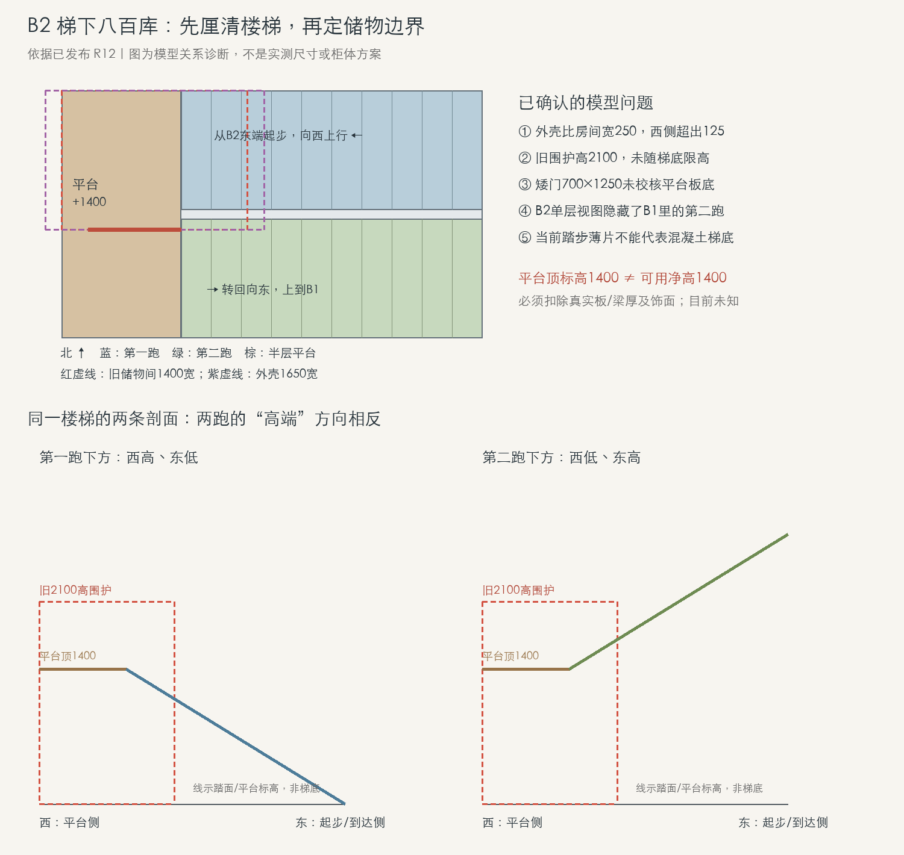

# 柜体与梯下储物阶段进度 · 2026-11-06

[手机友好进度页](https://lyx0599.github.io/lyhpvilla/design-progress/2026-11-06/) · [现有 R12 模型](https://lyx0599.github.io/lyhpvilla/model-preview/?floor=B2)

本次仅更新研究图文，线上模型仍为 R12。图形关系评估、实体建模、采用与合模分别记录；下列候选尚未合入，不代表施工、产品或舒适性确认。

## 当前状态

| 项目 | 已有进展 | 当前状态与下一步 |
| --- | --- | --- |
| 1F 餐边柜 R15 R02 | 本轮图形关系评估已过 | 实体建模中，尚未合入；核对实体与评估图的对应关系，再判断合入 |
| 2F 衣帽间四门 | 四门方向可继续深化 | 实体建模中，尚未合入；继续核对分门和使用关系 |
| B2 南柜与岛桌 | 候选继续评估 | 尚未合入；先理顺新旧对象、摆位与使用关系，不替换线上家具 |
| B2 梯下八百库 | 两跑、平台和旧储物占位已同坐标核对 | 关系诊断，尚未合入；按真实梯底与开口划分可用储物高度 |

## 楼梯与旧储物占位诊断

已有混凝土楼梯，本轮是既有梯下收纳与饰面研究，不默认新建结构。B2 单层视图隐藏了数据归在 B1 的另一跑；应结合两跑与半层平台判断，不以单层画面代替完整空间。

以下均为模型坐标及标高，单位 mm，非现场实测：

- 北侧第一跑：东端 X4123、标高0 → 西端 X1850、标高1400，Y3050…3950。
- 西侧半层平台：X950…1850，Y3050…4920，平台顶标高1400。
- 南侧第二跑：西端 X1850、标高1400 → 东端 X4123、标高2800，Y4020…4920；该跑在 B1 数据中。

已确认的问题：

1. 旧房间宽1400，外壳宽1650，相差250，外壳越西125，边界不一致。
2. 旧2100高围护是固定矩形占位，未随真实梯底限高，不能解释为可放2100高柜。
3. 旧门700×1250，中心X1500/Y4100，位于平台下。平台顶1400不是净高1400；真实板梁和饰面未知，1250门高未证。
4. 踏步薄片不代表混凝土梯底，现有矮货架高度也不是已求解的梯下净空。

诊断PNG只展示模型推导关系，不是实测、施工图、柜体采用方案或真实模型相机渲染。图中剖面线表示踏面／平台标高，不是梯底。

## 后续深化

平台下先研究低频矮箱；第一跑下西高东低，第二跑下向东升高，优先研究外侧分门取物。补核梯底与板梁下缘、既有侧墙／开口、完成面标高；不默认可以拆侧墙或打通各区。概念设计可继续，实体高度与门位须随真实约束修正，经过对应检查后再单独合入模型。

本次不提交未审柜体、楼梯结构或净空实体，不改变现有 R12 模型数据。
