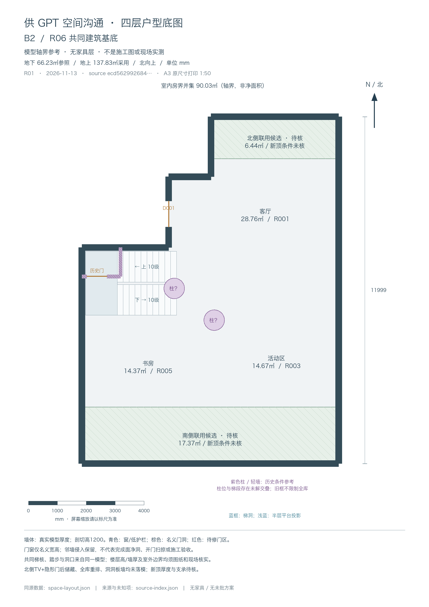
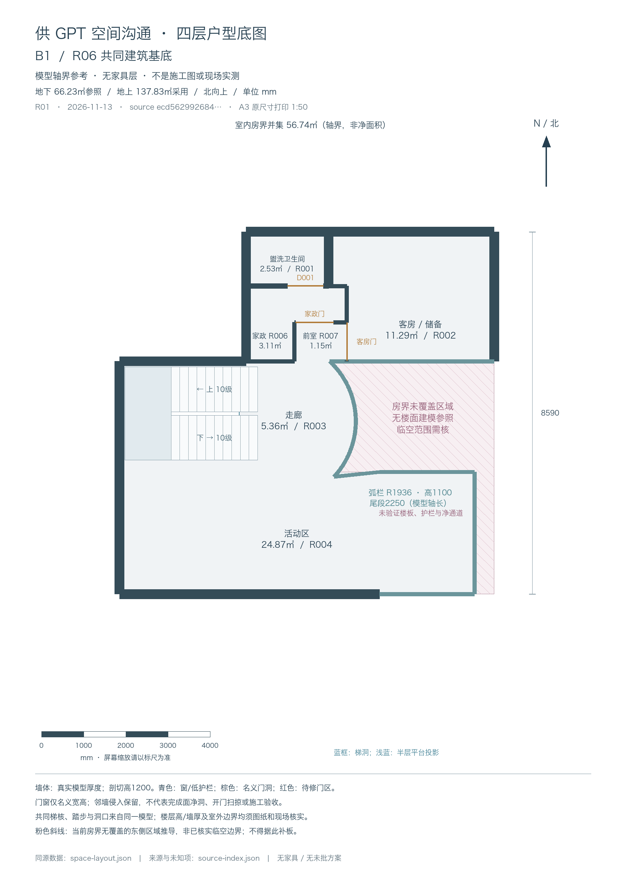
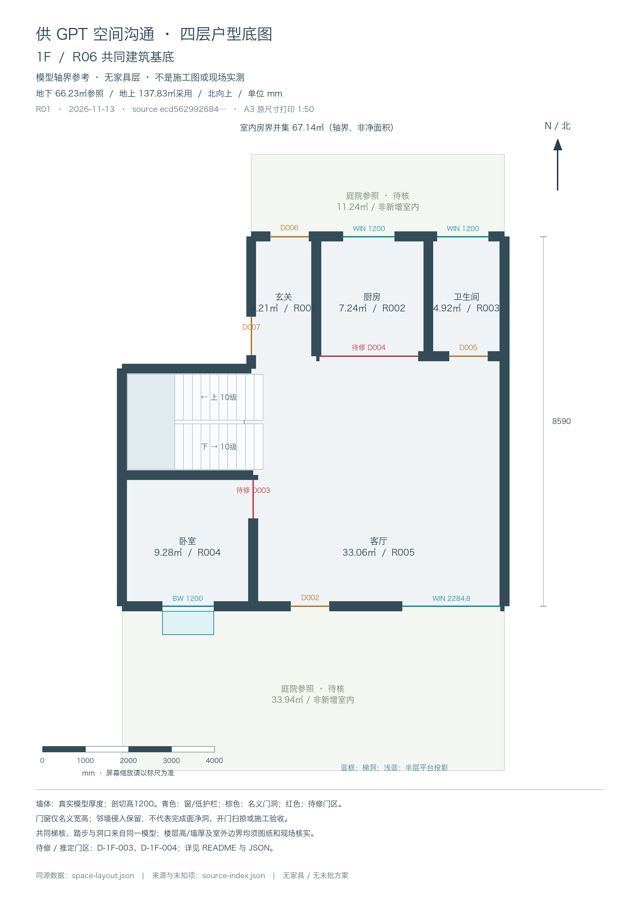
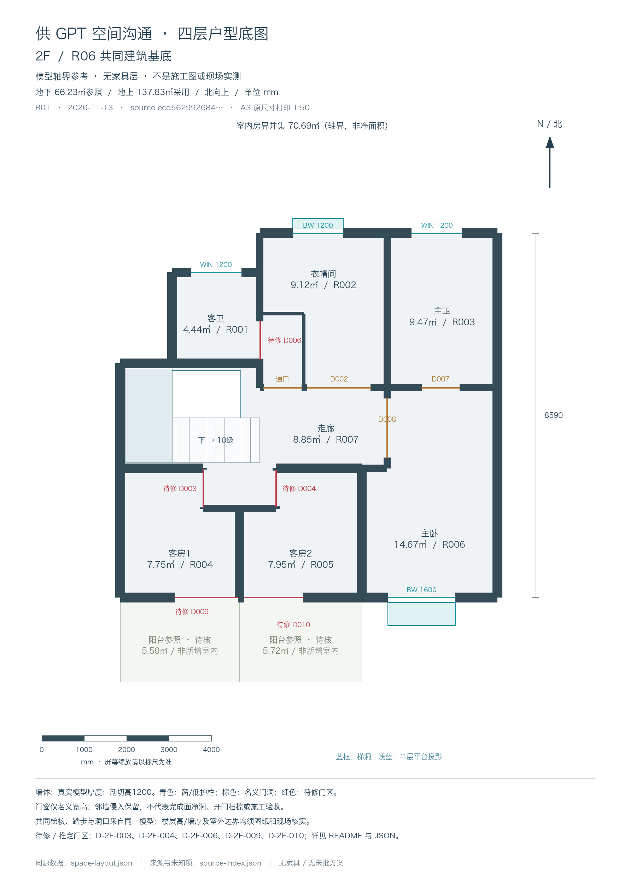

# 供 GPT 空间沟通的四层户型底图

本目录提供 B2、B1、1F、2F 的共同建筑参考，供空间布局讨论与后续深化读取。**它是模型坐标生成的平面底图，不是家具终版、施工图、现场测绘或门洞验收结论。** 家具和正在复核的各层新方案均未叠入；现有模型问题没有被绘图修平。

- 资料 revision：`FLOORPLAN-REFERENCE-20261113-R01`
- 共同建筑 revision：`AREA6623-FOUR-FLOOR-ARCHITECTURE-20261113-R06`
- 来源模型 SHA-256：`ecd562992684907b4365a5b54cb627fd23c099f20d308c130ea015715c75cfd3`
- 生产基准 commit：`14d1cce3677094104248c668be959a44fd749633`。本目录是独立文档资料，不修改应用模型或 Pages。
- 图纸统一北向上，X 向东、Y 向南；几何单位 mm。SVG 页面为 A3（297 × 420 mm），原尺寸打印比例 **1:50**；PNG 为 1782 × 2520，152.4 dpi。屏幕缩放时请使用图上的毫米标尺。

## 文件入口

| 楼层 | 可读图片 | 矢量图 | 当前房界轴线并集 |
|---|---|---|---:|
| B2 | [B2.png](B2.png) | [B2.svg](B2.svg) | 90.033770 ㎡ |
| B1 | [B1.png](B1.png) | [B1.svg](B1.svg) | 56.741159 ㎡ |
| 1F | [1F.png](1F.png) | [1F.svg](1F.svg) | 67.142378 ㎡ |
| 2F | [2F.png](2F.png) | [2F.svg](2F.svg) | 70.687562 ㎡ |

机器可读入口：[space-layout.json](space-layout.json)。来源对象 ID、投影规则、未知项和图像文件 hash：[source-index.json](source-index.json)。JSON 使用白名单提取的建筑数据，不包含完整工作模型、私人合同原文、身份、家庭物品清单或财务资料。

面积均是房界轴线多边形并集，**不是完成面净面积、产权面积或新增建筑面积**。房间局部区可能相叠，不能简单相加。地下原范围采用 **66.23 ㎡参照**；B2 北侧联用候选 6.436746 ㎡、南侧联用候选 17.367024 ㎡，合计增加 23.803770 ㎡参考范围，形成 90.033770 ㎡模型轴界。地上 1F + 2F 当前模型合计 **137.829940 ㎡（137.83 ㎡采用）**。庭院、阳台单独着色，不加入上述房界并集。

## 如何给 GPT 读取

将当前固定 commit 下的本 README、对应楼层 PNG，以及 `space-layout.json` 一起提供给具有链接读取能力的 GPT。若该客户端无法读取 GitHub 文件，请下载上述文件后附加；仓库公开不保证每个客户端都能自动抓取。

可附以下要求：

> 请先读 README 的已知问题与边界，再读 space-layout.json。以北向上、毫米坐标分析空间布局，引用原始对象 ID。区分现有模型、来源未证实的条件参考、尚未设计的意图。保持共享梯核、真实墙厚、B1 R1936 弧栏和2250尾段，不把名义门宽当净洞，不通过移动未核实结构消除问题。先说明需要核实的数据，再提出可回退的方案。

## 图例与投影

深色墙体是来源模型的真实厚度，平面剖切高为本层 1200 mm。门、窗、飘窗只切除其**自身宿主墙**中相应标高的名义洞口，相邻墙体完整保留。棕线是名义门洞轴线；青线是窗或低护栏；红线及“待修”是下表的已知门区问题。没有开门扫掠图，不能据此判断门扇是否能操作。

飘窗按原生模型的宿主法线与 `projectionDirection` 规则生成投影，保留旧模型未指定朝向时的原生表现；图上投影不能新增证明其存在性或进出方向。1F `BW-1F-003` 保留名义 1200 × 550 × 1400，未画成未经证明的低窗洞或坐榻。JSON 的 `derivedBottomMm` / `derivedTopMm` 记录原生标高推导。

共享梯核含原始 6 梯段、3 半层平台及3梯洞。踏步用实际端点、平台深度退让后的梯跑和步数生成，不按房间方框猜测。每梯段宽 1065.974 mm、10 级、升高1400 mm；平台深1095.771 mm；扣平台后的模型梯跑2051.658 mm。层高2800 mm等均是模型估计值。2F只显示其下行梯段；B2补显其连接上层的另一梯段投影。蓝色线框是本层梯洞，浅蓝平台是半层投影，**不是新增本层楼板**。完整梯组注册偏移属于模型坐标纠正，不授权移动现场既有混凝土楼梯。

B1 的 R1936 弧栏、1100 高低护栏及2250轴长尾段均保留实际模型尺寸。粉色斜线区是“共同包围范围减房界并集”得到的东侧无房界覆盖区域，用于提醒当前模型没有该处房界楼面；**不是已核实的临空或楼板边界**。西北外部凹角没有画成临空。不得由该斜线图反推出已获批准的挑空、补板、护栏安全或楼板承载。

B2 绿色斜线是南北联用候选室内边界。原900采光井门及分隔墙已从当前活动建筑模型退役，不能作为新设计中仍存在的门。新顶仅是本层局部2800 mm的零厚度建议平面；厚度、支承、防水和拆改条件未核。东翼及未证明属于本范围的东南侧均不计入。

紫色柱和梯下轻墙保留历史条件参考，不能当作本户已证实结构。`COL-B2-002` 与梯段有5处已知交叠，两段历史梯下参考墙各有1处梯段交叠，共7处未解。图中没有藏柱或删墙制造无冲突假象；旧梯下局部框也不代表整体储藏的上限。

## 待修 / 推定门区：7 门、9 处墙角侵入

下列长度是独立复核得到的“邻墙覆盖名义洞口中心线长度”，**不是完成面可用净宽**，多邻墙长度也不能未经并集计算直接相减。来源估计精度远低于小数位；0.525 mm 等只说明数值求交结果，不代表现场测量精度。

| 门 ID | 邻墙 ID | 模型侵入中心线长度 mm |
|---|---|---:|
| D-1F-003 | W-1F-012 | 5.299 |
| D-1F-004 | W-1F-004 | 38.437 |
| D-2F-003 | W-2F-012 / W-2F-022 | 85.517 / 55.517 |
| D-2F-004 | W-2F-013 / W-2F-024 | 60.517 / 30.517 |
| D-2F-006 | W-2F-008 | 18.435 |
| D-2F-009 | W-2F-015 | 71.948 |
| D-2F-010 | W-2F-015 | 0.525 |

图上 `D003` 等标签保留对应楼层原始门编号。B1“家政门”对应 `D-B1-LAUNDRY-R01`，“客房门”对应 `D-B1-GUEST-R01`；2F“通口”对应 `D-2F-B-PUBLIC-OPENING`。B2“历史门”对应 `D-B2-STORAGE-001`，仅为条件参考。

客房侧两段门宿主轴长约948.965 mm，扣除相邻110及80半墙厚后连续轴线空间约758.965 mm；本包保留原名义洞口，不把宿主区间容纳当作净洞或施工通过。其余门的套线、扫掠和实际净洞也未因此获得验收。

## B2 新意图尚未落模

北墙100英寸电视意图、隐形门通向后侧储藏或入口、全库收纳重排，以及可能以洞洞板墙替代洞洞柜，均是后续讨论方向，**没有作为既定布局画入本包**。“八百库”指大件及密集储藏目标，不是800 mm宽度。现有用途名称仅帮助识别空间，不限制后续讨论。

## 四层图

### B2

### B1

### 1F

### 2F

